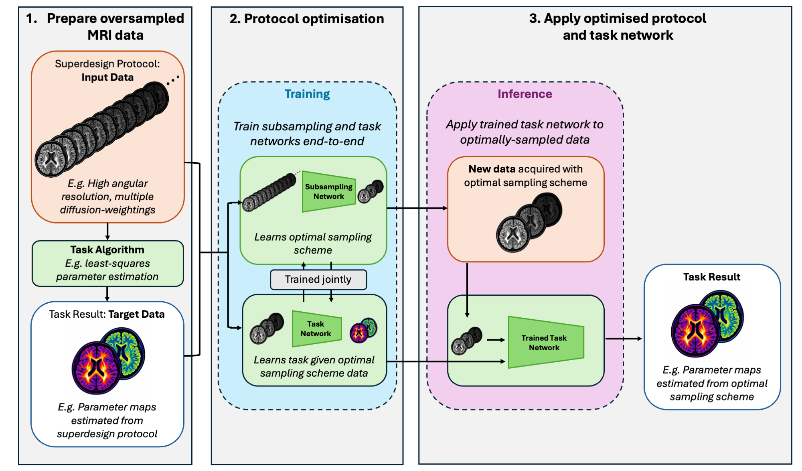

# EDMRI: A Machine Learning Framework for Experimental Design in Quantitative and Diffusion MRI

This is working code for an upcoming conference paper latest version [link](https://proceedings.iclr.cc/paper_files/paper/2024/hash/aec2dfc4f5e19acf05c15587c889dbc4-Abstract-Conference.html), and also an upcoming journal paper.

The neural-network based algorithm TADRED is available [here](https://github.com/sbb-gh/tadred).

If you find this repo useful, please consider citing the paper:

## Overview

This repo builds on the neural-network based algorithm TADRED (TAsk-DRiven Experimental Design in imaging) framework ([code](https://github.com/sbb-gh/tadred), [paper](https://proceedings.iclr.cc/paper_files/paper/2024/hash/aec2dfc4f5e19acf05c15587c889dbc4-Abstract-Conference.html)). The main additions are a series of wrapper functions that enable quick and easy optimisation of scanning protocols for quantitative and diffusion MRI.

The TADRED framework comprises a **subsampling network** and a **task nework**, which are trained jointly during optimisation. The subsampling network identifies the subpart of the data that bets supports a task, e.g. parameter mapping, and the task network is trained to undertake that task.


## Schematic



## Quick start
You can optimise a protocol and train a corresponding task network with the following command line arguments:

```
edmri-optimise \
data.input=examples/data/sandi/signals.npy \
data.target=examples/data/sandi/targets.npy \
data.superdesign=examples/data/sandi/sandi_superdesign_protocol.txt \
--no-hash
```

And then simulate some data as follows

```
python -m examples.generate_simulation_data --protocol results/optimisation_results/examples/sandi_tadred_protocol.txt
```


And then apply the trained task network to new data with 

```
edmri-apply \
task_network=results/optimisation_results/examples/tadred_results/trained_task_network.pt \ 
data.input=examples/data/sandi/sandi_tadred_signals.npy
```

## Typical usage pipeline

The typical EDMRI workflow consists of three stages:

1. **Prepare oversampled data:** Define a comprehensive MRI acquisition protocol (the *superdesign*) and generate training data using either real MRI acquisitions or simulations.
2. **Optimise the protocol:** Use TADRED to select an optimised subset of acquisitions and train a task-specific neural network.
3. **Apply the optimised protocol:** Acquire new real MRI data using the optimised protocol and apply the trained network to perform the task.

There are two approaches to protocol optimisation:

- **Real-data optimisation:** Acquire an oversampled real MRI dataset and use it to optimise the protocol.
- **Simulation-based optimisation:** Generate simulated MRI data and ground-truth labels to optimise the protocol without requiring an oversampled real MRI acquisition.

**Both approaches are intended to produce an optimised protocol and trained network that can be applied to real MRI data.** Simulated data can also be used during application for testing and benchmarking.

### 1. Prepare oversampled data

#### Step 1.1: Define the superdesign

**Define an oversampled MRI acquisition protocol** that comprehensively samples the acquisition parameters of interest (e.g. b-values, gradient directions, echo times, diffusion times...).

The superdesign should comprehensively cover the relevant acquisition parameter ranges within the scanner's capabilities. For real MRI, it should be a feasible but extensive research-grade acquisition, substantially longer than the intended optimised scan. For simulations, the superdesign can be even more extensive, provided the final optimised protocol remains feasible on the intended scanner. By default, TADRED selects 25% of the acquisitions in the superdesign for the optimised protocol, although this proportion can be easily adjusted.

Save the superdesign as a text file, for example `superdesign.txt`, with:

- **Columns:** Acquisition parameters in a consistent order. For example, the first three columns could specify the gradient direction, with the fourth specifying the b-value, and any additional acquisition parameters in subsequent columns. Any column order can be used, provided it remains consistent throughout the workflow.
- **Rows:** Individual acquisitions. For example, the first row could specify a b = 0 s/mm² acquisition with gradient direction [0, 0, 0], and the second a b = 1000 s/mm² acquisition with gradient direction [1, 0, 0].

The resulting array should have dimensions **[T, M]**, where:

- `T` is the total number of acquisitions in the superdesign.
- `M` is the number of independent acquisition parameters.

#### Step 1.2: Generate input and target data

Choose one of the following approaches to generate the data used for optimisation.

**Option A: Optimisation using real MRI data**

1. **Acquire oversampled MRI data** using the superdesign. Save the data as a 4D NIfTI file, for example `superdesign_data.nii.gz`, with dimensions **[X, Y, Z, T]**.

2. **Generate the corresponding task outputs** using the complete oversampled dataset. For example, for parameter estimation, fit a model to the oversampled data to generate parameter maps. Save these as `superdesign_target.nii.gz`, with dimensions **[X, Y, Z, P]**, where `P` is the number of target parameters.

The oversampled MRI data serve as the **input data for TADRED**, while the corresponding task outputs serve as the **target data**.

**Option B: Optimisation using simulated MRI data**

1. **Generate ground-truth task labels** for `N` simulated voxels or samples. These should comprehensively cover the range of target values of interest. For example, for parameter estimation, generate combinations of ground-truth model parameters. Save these as `superdesign_target.npy`, with dimensions **[N, P]**, where `P` is the number of target parameters.

2. **Simulate MRI signals** using the superdesign and the generated ground-truth parameters. Save the simulated signals as `superdesign_data.npy`, with dimensions **[N, T]**.

The simulated MRI signals serve as the **input data for TADRED**, while the ground-truth labels serve as the **target data**.

This approach allows the acquisition protocol and task network to be optimised using simulations, before applying them to real MRI data.

**For both approaches:**

- Input and target data must correspond to the same voxels or samples.
- The number and order of acquisitions in the input data must match the rows of `superdesign.txt`.

### 2. Optimise the acquisition protocol

Once the superdesign, input data and target data have been prepared, run TADRED to optimise the acquisition protocol and train the task network.

For simulation-based optimisation:

```bash
edmri-optimise \
    data.input=superdesign_data.npy \
    data.target=superdesign_target.npy \
    data.superdesign=superdesign.txt \
    output.directory=optimisation_results \ 
```

For real-data optimisation, replace the `.npy` filenames with the corresponding `.nii.gz` files.

This produces two main outputs:

1. **Optimised acquisition protocol:** A subset of acquisitions selected from the superdesign to efficiently perform the target task.

   Saved to:
   `optimisation_results/<UNIQUE_HASH>/tadred_results/optimised_protocol.txt`

	By default, the optimised protocol contains 25% of the acquisitions in the superdesign. This can be adjusted using the `optimisation.protocol_size` argument in `edmri-optimise`. For example, `optimisation.protocol_size=0.5` retains 50% of the acquisitions.

2. **Trained task network:** A neural network trained to perform the target task using only measurements from the optimised protocol.

   Saved to:
   `optimisation_results/<UNIQUE_HASH>/tadred_results/trained_task_network.pt`

The `<UNIQUE_HASH>` directory identifies the specific optimisation run and its configuration.

### 3. Apply the optimised protocol to new MRI data

**The primary application of EDMRI is to use the optimised protocol and trained task network on new real MRI data**, regardless of whether optimisation was performed using real or simulated data.

#### Step 3.1: Acquire real MRI data

**Acquire new real MRI data** using `optimised_protocol.txt`.

Save the data as a 4D NIfTI file, for example `tadred_data.nii.gz`, with dimensions **[X, Y, Z, C]**, where `C` is the number of acquisitions in the optimised protocol.

The acquisitions must be performed in the same order as the optimised protocol used during training.

#### Step 3.2: Apply the trained task network

Run:

```bash
edmri-apply \
    task_network=optimisation_results/<UNIQUE_HASH>/tadred_results/trained_task_network.pt \
    data.input=tadred_data.nii.gz
```

The trained network performs the target task using the newly acquired MRI data. For example, for parameter estimation, it generates parameter maps from the optimised MRI measurements.

**Note:** `edmri-apply` does not require `optimised_protocol.txt` as an additional input because the task network has already been trained specifically for that protocol. However, the new MRI data must contain the correct acquisitions in the correct order.

#### Optional: Testing and benchmarking using simulated data

The optimised protocol and trained task network can also be evaluated using simulated MRI data.

1. **Simulate new MRI data** using `optimised_protocol.txt`. Save the data as `tadred_data.npy`, with dimensions **[N, C]**.

2. **Apply the trained task network:**

```bash
edmri-apply \
    task_network=optimisation_results/<UNIQUE_HASH>/tadred_results/trained_task_network.pt \
    data.input=tadred_data.npy
```

3. **Evaluate performance** by comparing the network predictions against the known ground-truth labels.

This provides a way to assess the accuracy and robustness of the optimised protocol before or alongside its application to real MRI data.


## Contact

stefano.blumberg.17@ucl.ac.uk

slatorp@cardiff.ac.uk


## Installation

We provide example instructions to first create an environment, then install packages within this environment.  We recommend users use an environment to isolate all modules from the global environment.

The steps below install everything in a top level directory called ```<INSTALL_DIR>``` which contains the virtual enviroment files, ED_MRI installation, and TADRED installation. This is the recommended structure and is assumed by some of the example notebooks.

We have given instuctions for a generic python version. We have sucessfully tested using various python versions but recommend using Python v3.10.4.  We recommend [pyenv](https://github.com/pyenv) for python version management.

The code is fully tested using PyTorch v2.0.0, cuda 11.7 on the GPU, dipy v1.5.0, nibabel v5.1.0, and dmipy v1.0.5.


### Installation Part 1: Directory set up
First create and move to the desired installation directory.

```
mkdir <INSTALL_DIR>
cd <INSTALL_DIR>
```

### Installation Part 2: ED_MRI repo
Clone this ED_MRI repo to ```<INSTALL_DIR>``` as follows.

```bash
git clone https://github.com/sbb-gh/ED_MRI.git
```

### Installation Part 3: TADRED repo
Now clone the relevant fork of the TADRED code to ```<INSTALL_DIR>``` as follows.

```bash
git clone https://github.com/PaddySlator/tadred.git
```

The relevant fork of the TADRED github repo is located [here](https://github.com/PaddySlator/tadred/tree/main).

<!--TODO: You can also use pip install (doesn't work on mac)

```bash
pip install git+https://github.com/sbb-gh/tadred.git@main
```-->


### Installation Part 4: Environment

Now create an activate a virtual environment in ```<INSTALL_DIR>```.  We provide two examples either using venv or Conda:

#### Option 1: Install Environment Using python venv module
The venv documentation is [here](https://docs.python.org/3/library/venv.html).

```bash
python -m venv .venv
source .venv/bin/activate
```

#### Option 2: Install Environment Using Conda
Conda documentation is [here](https://docs.conda.io/en/latest/).

```bash
conda create -n ED_MRI_env python=3.10.4
conda activate ED_MRI_env
```


### Installation Part 5: TADRED and Dependencies

Now install TADRED and the dependencies using pip.

After first updating pip, install TADRED

```bash
pip install --upgrade pip
cd tadred
pip install -e .
```

and then the additional dependencies

```bash
pip install notebook matplotlib scipy nibabel
```


<!--#### TADRED dependencies

TADRED requires pytorch, numpy, pyyaml, and hydra which can be installed as follows:

```bash
pip install torch==2.0.0 torchvision==0.15.1 torchaudio==2.0.1
pip install pyyaml hydra-core==1.3
pip install numpy
```

#### ED_MRI dependencies
Required to run the example jupyter notebooks:

```bash
pip install notebook
```-->

#### [Optional] Full dependencies for replication of results
Optional modules to generate the data and run a full replication of the results: dipy, dmipy, nibabel. Note that dmipy is no longer supported and can often be difficult to install. If you are struggling try cloning this repo https://github.com/PaddySlator/dmipy into ```<INSTALL_DIR>``` instead.


```bash
pip install git+https://github.com/AthenaEPI/dmipy.git@1.0.1
pip install dipy==1.9.0
pip install nibabel==5.1.0
```


<!--```bash
pip install numpy==1.23.4 git+https://github.com/AthenaEPI/dmipy.git@1.0.1
pip install dipy==1.9.0
pip install nibabel==5.1.0
pip install git+https://github.com/sbb-gh/tadred.git@main # can also install tadred from source to examine/modify files from www.github.com/sbb-gh/tadred
pip install notebook
```-->


<!--We provide two options for installing the code:-->

<!--#### Python Package from Source

```bash
pip install git+https://github.com/sbb-gh/ED_MRI.git@main notebook
```-->


<!--```bash
pip install numpy==1.23.4 git+https://github.com/AthenaEPI/dmipy.git@1.0.1
pip install dipy==1.9.0
pip install nibabel==5.1.0
pip install git+https://github.com/sbb-gh/tadred.git@main # can also install tadred from source to examine/modify files from www.github.com/sbb-gh/tadred
pip install notebook
```-->


## Quick start instructions: optimising an acquisition protocol from simulated data

We anticipant that many code users will want to design an acquisition scheme optimised for their model of choice. This can be done by following the steps in *optimise\_protocol\_from\_simulated\_data\_tutorial.ipynb.*

To summarize, the required steps are as follows.

### Step 1. Simulate data for a super-design acquisition scheme using your chosen
 model
A "super-design" is a rich acquisition scheme that covers the space of available acquisition parameters. For example to design a diffusion MRI experiment with maximum b-value 3 ms/μm<sup>2</sup>, an appropriate super design might be b=0, 0.01, 0.02, 0.03,..., 2.99, 3 ms/μm<sup>2</sup> with 20 gradient directions at each b-value (20 × 300 = 6000 total measurements).

To simulate data, you can utilise the signal equation of your model of choice (whether diffusion MRI or quantitative MRI). See *optimise\_protocol\_from\_simulated\_data_tutorial.ipynb* for an example

The output from your simulations should be three .npy files:

* *model\_name*\_parameters_gt.npy: array containing the simulation ground truth parameters
* *model\_name*\_signals_super.npy: array containing the simulation super-design signals
* *model\_name*\_signals_super.npy: array containing the simulation super-design acquisition parameters

### Step 2. Train TADRED on the simulated data

The above three files are then used as input for *optimise\_protocol\_from\_simulated\_data\_tutorial.ipynb.*

## Replicating Results in Paper

First install the environment and enter the environment, as explained above.  Then simply run

```bash
python paper_experiments.py
```

## Tutorial

We provide a more comprehensive and in depth
 tutorial [in tutorial.py](./examples/tutorial.py).  This provides an example of generating simple data, loading the data into TADRED, and various hyperparameter choices for TADRED with options to save the results.

